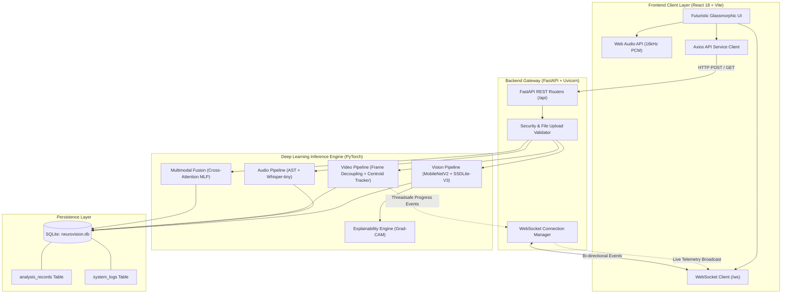

# NeuroVision: System Architecture & Dataflow Blueprints

**NeuroVision: Intelligent Multimodal Pattern Analysis Using Deep Learning**  
*Master of Computer Applications (MCA) Major Project*

---

## 1. Architecture Overview

NeuroVision employs an asynchronous, decoupled client-server architecture engineered for high-throughput multimodal deep learning inference and real-time telemetry streaming.

The system is organized into four core layers:
1. **Interactive Client Layer (Frontend)**: React 18 SPA with futuristic glassmorphism UI, real-time Web Audio API signal processing, and WebSocket client subscriptions.
2. **Asynchronous API & Messaging Gateway (Backend)**: FastAPI (ASGI) providing REST routing, multipart validation, and a centralized WebSocket connection manager.
3. **Deep Learning Inference Engine**: PyTorch execution pipelines across vision, audio, temporal video, multimodal fusion, and Explainable AI (Grad-CAM).
4. **Persistence & Audit Layer**: SQLite relational database managed via SQLAlchemy ORM for analysis history, metric rollups, and audit telemetry.

---

## 2. Master System Architecture Diagram



### 2.1 Multimodal Pipeline & Dataflow Diagram

```text
                  NEUROVISION
                       |
              FRONTEND INTERFACE
                       |
        +--------------+--------------+
        |              |              |
      VISION          AUDIO          VIDEO
        |              |              |
        v              v              v
   Image Model     Audio Model    Frame Processing
   (MobileNetV2)      (AST)         (Decoupling)
        |              |              |
        v              v              v
 Vision Features Audio Features Video Features
   (1280-dim)      (768-dim)     (Bounding Boxes)
        |              |              |
        +--------------+--------------+
                       |
              MULTIMODAL FUSION
          (Cross-Attention Deep MLP)
                       |
                       v
                PATTERN ANALYSIS
                       |
             +---------+---------+
             |                   |
             v                   v
       Final Prediction     Explanation
             |              (Grad-CAM Spatial Heatmap)
             v                   |
          Confidence             |
        (Calibrated)             |
             |                   |
             +---------+---------+
                       |
                       v
              REAL-TIME DASHBOARD
             (WebSocket Telemetry)
                       |
                       v
               SQLITE DATABASE
             (neurovision.db)
```

---

## 3. Frontend Architecture

* **Entry Point**: [`frontend/src/main.jsx`](file:///d:/MY%20PROJECT/neurovision/frontend/src/main.jsx) mounts root component into `#root`.
* **Central Navigation Hub**: [`frontend/src/App.jsx`](file:///d:/MY%20PROJECT/neurovision/frontend/src/App.jsx) controls active tab states (`dashboard`, `vision`, `video`, `audio`, `audio-live`, `multimodal`, `analytics`, `about`, `demo`).
* **Guided Demo Mode**: [`frontend/src/pages/DemoModePage.jsx`](file:///d:/MY%20PROJECT/neurovision/frontend/src/pages/DemoModePage.jsx) provides a 10-step evaluator demonstration flow with Evaluator Guidance Cards, System Status Panel, Live Metrics Panel, and authentic AI inference.
* **Custom Hooks**:
  - `useHealthCheck(interval)`: Polls `/api/health` every 5 seconds to track backend connectivity and round-trip network latency.
  - `useWebSocket()`: Manages `/ws` socket lifecycle, automatic reconnect backoff, and event dispatching.
* **Component Design System**:
  - `GlassPanel` & `GlassCard`: Reusable glassmorphic panels (`backdrop-filter: blur(16px)`).
  - `AnimatedBackground`: Hardware-accelerated SVG vectors, atmospheric radial gradients, and digital floor grids (`pointer-events-none`).
  - `AIBrainVisualization` & `AIFusionVisualization`: Interactive neural topology canvases.

---

## 4. Backend Architecture

* **Application Entry**: [`backend/app/main.py`](file:///d:/MY%20PROJECT/neurovision/backend/app/main.py) registers routers, lifespan handlers, exception handlers, and CORS policies.
* **API Routers (`backend/app/api/`)**:
  - `vision.py`: Endpoints for image classification, SSDLite detection, and Grad-CAM.
  - `video.py`: Endpoints for video upload, job polling, cancellation, and results.
  - `audio.py`: Endpoints for audio classification, Whisper transcription, and streaming.
  - `fusion.py`: Endpoints for multimodal feature extraction and joint fusion.
  - `analytics.py`: Endpoints for database querying, summary statistics, and history.
  - `xai.py`: Dedicated explainability endpoints.
* **Job Managers (`backend/app/services/`)**:
  - `video_job_manager.py`: Runs background daemon threads to process video frames asynchronously without blocking the FastAPI event loop. Dispatches thread-safe progress events via `broadcast_threadsafe()`.
  - `audio_job_manager.py`: Decouples and segments audio waveforms for batch AST inference.
  - `analytics_service.py`: Encapsulates database transactions, rolling statistics, and search filters.

---

## 5. Database Schema & Persistence Architecture

The database resides at `d:\MY PROJECT\neurovision\backend\database\neurovision.db` using SQLite3:

### 5.1. `analysis_records` Table
Stores immutable records of all completed model inferences:
* `id` (INTEGER, Primary Key, Autoincrement)
* `analysis_id` (VARCHAR(36), Unique, Indexed, UUID4)
* `analysis_type` (VARCHAR(30), Indexed: `'vision'`, `'audio'`, `'video'`, `'multimodal'`)
* `filename` (VARCHAR(255), Nullable)
* `prediction_label` (VARCHAR(100), Indexed)
* `confidence` (FLOAT, 0.0 – 1.0)
* `confidence_percentage` (FLOAT, 0.0 – 100.0)
* `processing_time_ms` (FLOAT, Latency in milliseconds)
* `model_name` (VARCHAR(100))
* `modalities_used` (VARCHAR(100))
* `status` (VARCHAR(30): `'completed'`, `'failed'`, `'partial'`)
* `details_json` (TEXT, Full structured output payload)
* `created_at` (DATETIME, Indexed, UTC Timestamp)

### 5.2. `system_logs` Table
Audit trail recording system startup, module initializations, and errors:
* `id` (INTEGER, Primary Key, Autoincrement)
* `event_type` (VARCHAR(50), e.g. `'STARTUP'`, `'ERROR'`, `'WEBSOCKET'`)
* `message` (VARCHAR(255))
* `created_at` (DATETIME, UTC Timestamp)

---

## 6. End-to-End Processing Dataflows

### 6.1. Image Analysis & Explainability Flow
```
1. User drops image (.jpg / .png)
   │
2. Frontend verifies format & size (< 15MB)
   │
3. POST /api/vision/analyze (multipart/form-data)
   │
4. Backend inspects magic bytes & decodes via OpenCV
   │
5. PyTorch MobileNetV2 executes feedforward classification
   │
6. PyTorch SSDLite-V3 detects bounding box candidates + NMS
   │
7. Grad-CAM backpropagates gradients from target class -> computes 2D heatmap
   │
8. Database records analysis result in analysis_records
   │
9. WebSocket broadcasts "vision.analysis.completed"
   │
10. UI renders annotated visualizer with Grad-CAM toggle & confidence metrics
```

### 6.2. Video Analysis Flow
```
1. User uploads video (.mp4)
   │
2. POST /api/video/upload -> receives job_id ("vid_job_...")
   │
3. Asynchronous VideoWorkerThread spawned
   │
4. Frame decoupling at 2.0 FPS via OpenCV VideoCapture
   │
5. Per-frame SSDLite detection + Centroid Tracking assignment
   │
6. Optical difference computed between adjacent frames
   │
7. Synthesizes annotated MP4 with overlaid tracking IDs
   │
8. Worker dispatches progress events via broadcast_threadsafe() to /ws
   │
9. Results cached in memory and recorded to database
```

### 6.3. Audio Analysis Flow
```
1. User uploads audio (.wav, .mp3) or records from microphone
   │
2. POST /api/audio/analyze (or /analyze-stream)
   │
3. Librosa resamples to 16 kHz mono & extracts Mel-spectrogram
   │
4. AST Transformer processes 16x16 spectrogram patches -> 527 AudioSet classes
   │
5. Whisper-tiny performs beam-search speech-to-text decoding
   │
6. Librosa computes ZCR, Spectral Centroid, and RMS energy
   │
7. Database logs record; UI visualizes interactive waveform and frequency bars
```

### 6.4. Multimodal Fusion Flow
```
1. User provides Image + Audio (or video containing both streams)
   │
2. POST /api/fusion/analyze
   │
3. Vision pipeline extracts 1280-dim visual embedding
   │
4. Audio pipeline extracts 768-dim acoustic embedding
   │
5. Concatenation layer constructs 2048-dim multimodal joint vector
   │
6. Cross-attention MLP projects representation into fused semantic categories
   │
7. Modality contribution weights calculated via feature attribution
   │
8. Fallback handler handles unimodal requests if one modality is absent
```

---

## 7. Real-Time WebSocket Communication Architecture

* **Endpoint**: `/ws` on port 8000.
* **Connection Lifecycle**:
  - Client connects -> Server stores socket in `ConnectionManager.active_connections`.
  - Immediate handshake event `connection.established` sent to client.
  - Periodic `ping` -> `pong` round-trip latency evaluation.
  - Dead or disconnected sockets pruned automatically upon failed transmission.
* **Security Guardrail**: Incoming frames are capped at 64KB (`65536` bytes). Malformed JSON or oversized frames trigger structured `system.error` events without disconnecting the socket.
* **Thread-Safety**: Background analysis worker threads call `broadcast_threadsafe()`, which safely injects broadcast coroutines into the running asyncio event loop using `asyncio.run_coroutine_threadsafe()`.

---

## 8. Architectural Limitations

* **Single-Node Execution**: In this implementation, worker threads run in-process within FastAPI. For multi-node cluster deployment, Celery with Redis could serve as an external distributed task queue.
* **SQLite Concurrency**: SQLite supports single-writer concurrency. For enterprise production, migrating to PostgreSQL or MySQL is supported by changing the SQLAlchemy connection string in `backend/app/core/config.py`.
